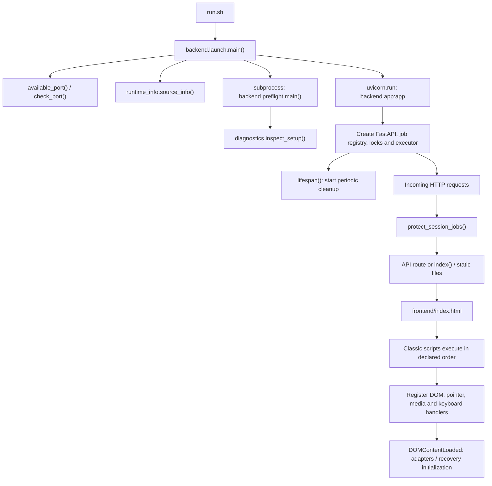
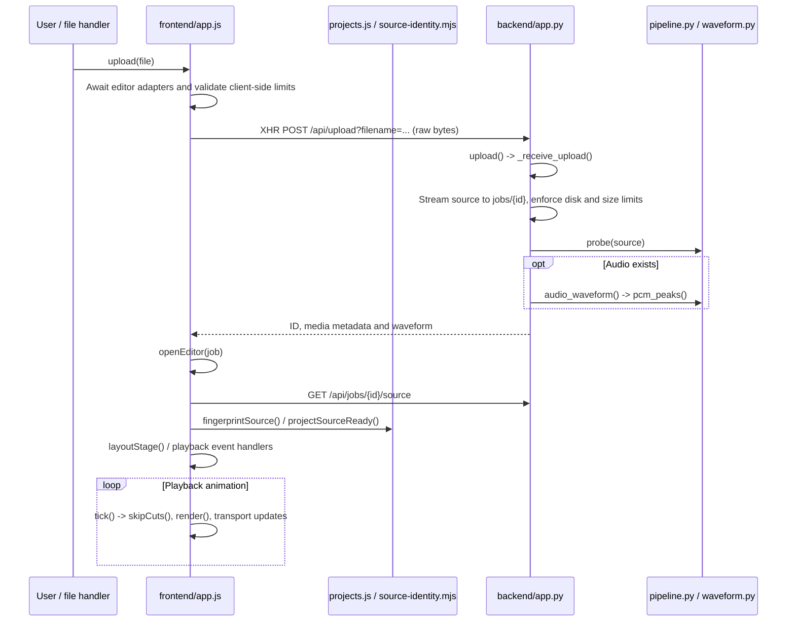
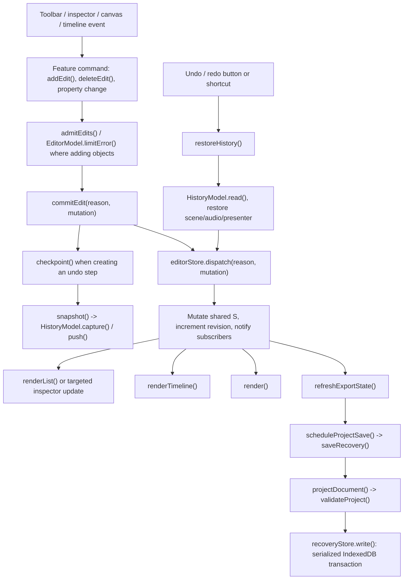
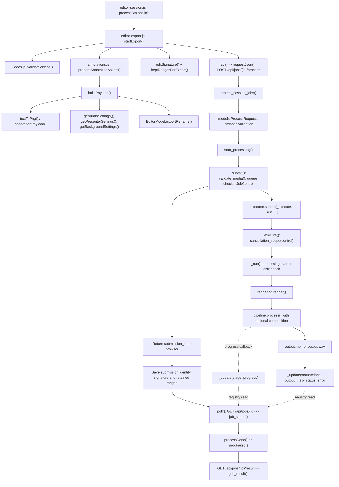
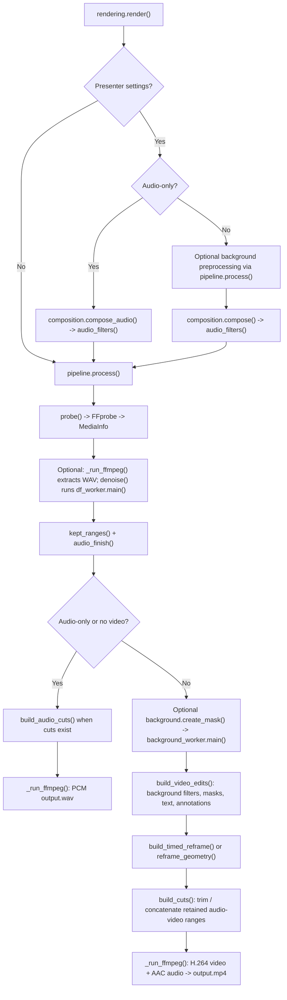
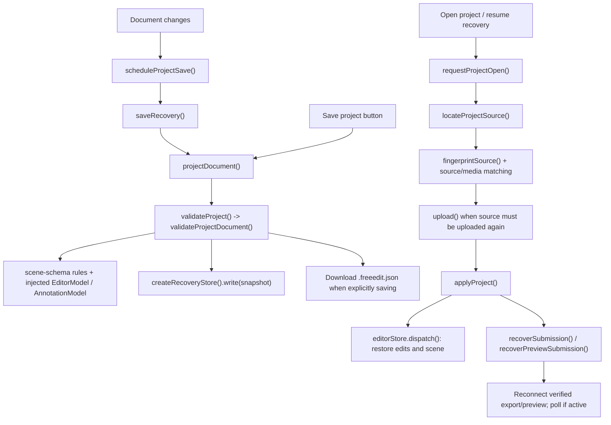
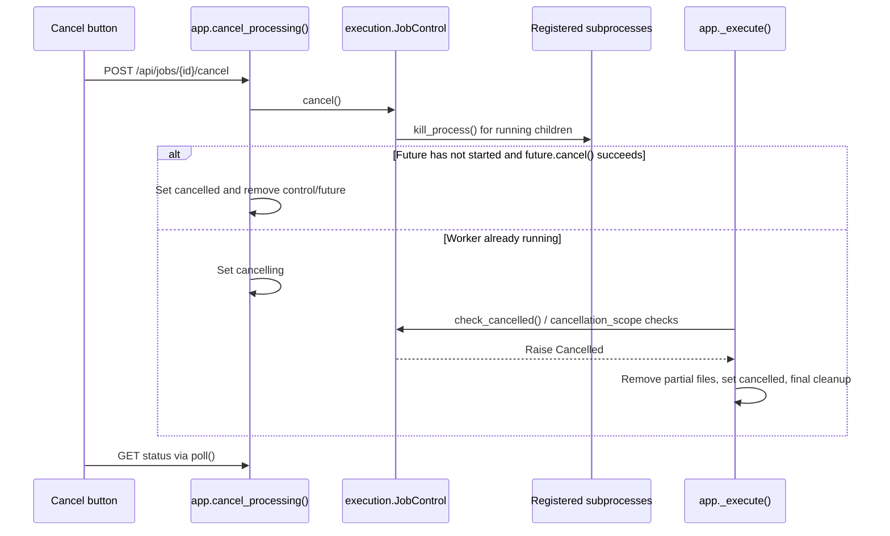

# FreeEdit code flow and function reference

This reference describes the checked-out source. Arrows in flowcharts show calls or explicitly labelled data/event boundaries. Branches marked optional run only when the corresponding feature is enabled. The application is event-driven: there is no single function that calls every frontend module.

## 1. Startup and script initialization

`theme.js` runs in the page head. The body scripts load in this order:

`ui → media-utils → editor-model → annotation-model → history-model → app → editor-render → editor-edits → editor-history → editor-export → editor-session → silence → timeline → projects → noise-preview → background → videos → workspace → reframe-captions → annotations → range-selection → result-preview`.

Classic scripts share lexical state and callbacks. Native `.mjs` modules provide transport, schemas, identity, storage and export timing rules; adapters load them asynchronously. Registration order is not the same as user-action execution order.

## 2. Upload and playback

The original source stays on the server. The browser plays that source and draws visual editing overlays. Source fingerprinting hashes every file byte in bounded chunks; project files reference this identity rather than embedding recordings.

## 3. Document mutation, rendering and undo

`S.edits` stores all timed objects. `S.selected` is an edit ID. Scene-level background, presenter, audio and global Reframe settings are separate from timed edits. Playback and drag state may be updated directly; some feature handlers explicitly checkpoint or dispatch rather than passing through `commitEdit()`. Continuous drags avoid creating an undo entry for every pointer movement.

## 4. Full export: exact primary call chain

`buildPayload()` splits cuts from visual overlays, rasterizes text/annotations, and projects timed Reframe edits into sections. Server validation rejects unknown request fields and checks edit ranges against actual media. Processing is serialized by `ThreadPoolExecutor(max_workers=1)`; queue capacity is checked separately. Browser polling normally starts with an 800 ms delay and backs off on connection errors.

## 5. Rendering internals

The graph describes logical filter construction; most video effects execute together inside one FFmpeg invocation. Reframe and overlays use original-source timestamps before cuts. `_run_ffmpeg()` reads FFmpeg progress, enforces a timeout and propagates cancellation and failures.

## 6. Preview and analysis routes

All six operations enter `_submit()` and `_execute()`; the selected worker determines the work and status/result fields. Preview/analysis success generally restores `uploaded` or `done` depending on whether a full export already exists.

| Browser trigger | POST suffix under `/api/jobs/{id}` | Backend handler → worker | Processing and browser completion |
|---|---|---|---|
| Export button | `/process` | `start_processing → _run` | `rendering.render → pipeline.process`; `poll → processDone` |
| Detect pauses (`silence.js`) | `/silence` | `analyze_silence → _analyze_silence` | `pipeline.detect_silence`; `poll → silenceDone`; paginated GET `/silence-results` |
| Noise sample (`noise-preview.js`) | `/preview` | `preview_noise → _preview_noise` | `pipeline.noise_preview`; `poll → noisePreviewDone`; GET `/preview/{variant}` |
| Background preview (`background.js`) | `/background-preview` | `preview_background → _preview_background` | Background sample processing; `poll → backgroundPreviewDone` |
| Presenter preview (`videos.js`) | `/composition-preview` | `preview_composition → _preview_composition` | `composition.compose`; `poll → compositionPreviewDone` |
| Processed range (`result-preview.js`) | `/result-preview` | `preview_result → _preview_result` | `rendering.preview → render`; `poll → resultPreviewDone` |

`rendering.preview()` prepares a source window, shifts edits into that window's local clock, preserves complete animation/Reframe intervals, computes retained ranges and calls the same `render()` contract used by a full export. `_preview_result()` can reuse a matching cached result.

## 7. Project save, import and recovery

Project schema v2 stores source identity, edits, scene settings and playhead view. Recovery also tracks export/preview submission identities so later edits cannot be mistaken for an older render. IndexedDB writes are serialized and snapshot values are copied before queuing. A small localStorage lease determines which tab owns recovery.

## 8. Cancellation and cleanup

`lifespan()` schedules `_cleanup_old_jobs()` every minute. Active uploads and queued/processing/cancelling jobs are protected. Authorized reads refresh inactivity retention at a bounded rate; `touchOpenRecording()` sends browser heartbeats. Deleting a job uses `delete_job()` and is separate from cancelling work.

## 9. File responsibilities and function index

The following index is extracted from source declarations. Python entries include methods and nested helpers; JavaScript entries include named function declarations and named arrow assignments. Anonymous DOM handlers are represented by the event flows above rather than assigned invented function names. Entries are navigation references, not an assertion that functions execute in declaration order.

### frontend/

#### `frontend/annotation-model.js`

Pure annotation defaults, validation, animation state, visible/preview timing and raster bounds.

- [`AnnotationModel()`](../frontend/annotation-model.js#L5)
- [`defaultEdit()`](../frontend/annotation-model.js#L17)
- [`validate()`](../frontend/annotation-model.js#L30)
- [`ease()`](../frontend/annotation-model.js#L48)
- [`animationState()`](../frontend/annotation-model.js#L49)
- [`visibleTime()`](../frontend/annotation-model.js#L58)
- [`previewTime()`](../frontend/annotation-model.js#L64)
- [`rasterBounds()`](../frontend/annotation-model.js#L72)

#### `frontend/annotations.js`

Loads annotation images, draws shapes/icons/callouts, manages placement and inspector choices, and rasterizes export assets.

- [`annotationImage()`](../frontend/annotations.js#L6)
- [`iconPreviewSvg()`](../frontend/annotations.js#L24)
- [`drawIconPath()`](../frontend/annotations.js#L28)
- [`paintAnnotation()`](../frontend/annotations.js#L37)
- [`prepareAnnotationAssets()`](../frontend/annotations.js#L67)
- [`annotationPayload()`](../frontend/annotations.js#L76)
- [`annotationTileSymbol()`](../frontend/annotations.js#L109)
- [`createAnnotationChoice()`](../frontend/annotations.js#L113)
- [`makeAnnotationChoiceGroups()`](../frontend/annotations.js#L133)
- [`refreshAnnotationPicker()`](../frontend/annotations.js#L185)
- [`annotationDefaultTimesFromPlayhead()`](../frontend/annotations.js#L205)
- [`armAnnotationPlacement()`](../frontend/annotations.js#L212)
- [`createAnnotationEditAt()`](../frontend/annotations.js#L220)
- [`positionExistingAnnotationAt()`](../frontend/annotations.js#L248)
- [`placeAnnotationAt()`](../frontend/annotations.js#L257)
- [`readAnnotationFile()`](../frontend/annotations.js#L274)
- [`image()`](../frontend/annotations.js#L278)
- [`loadAnnotationImage()`](../frontend/annotations.js#L312)
- [`changeAnnotationAnimation()`](../frontend/annotations.js#L336)
- [`current()`](../frontend/annotations.js#L341)
- [`buildAnnotationAnimationControls()`](../frontend/annotations.js#L354)
- [`button()`](../frontend/annotations.js#L360)
- [`buildAnnotationInspectorChoices()`](../frontend/annotations.js#L369)
- [`button()`](../frontend/annotations.js#L376)

#### `frontend/api-client.mjs`

Runs fetch with caller cancellation or default timeout, parses JSON and turns API failures into structured errors.

- [`requestJson()`](../frontend/api-client.mjs#L2)
- [`detail()`](../frontend/api-client.mjs#L7)

#### `frontend/app.js`

Owns shared editor/playback state, subscribes to document mutations, uploads source files, opens the editor and updates transport/layout. API calls delegate to the native transport module.

- [`commitEdit()`](../frontend/app.js#L32)
- [`clamp()`](../frontend/app.js#L77)
- [`sourcePlayer()`](../frontend/app.js#L79)
- [`duration()`](../frontend/app.js#L80)
- [`getEdit()`](../frontend/app.js#L81)
- [`isActive()`](../frontend/app.js#L82)
- [`show()`](../frontend/app.js#L83)
- [`api()`](../frontend/app.js#L86)
- [`upload()`](../frontend/app.js#L126)
- [`uploadFailed()`](../frontend/app.js#L183)
- [`openEditor()`](../frontend/app.js#L193)
- [`layoutStage()`](../frontend/app.js#L260)
- [`skipCuts()`](../frontend/app.js#L300)
- [`c()`](../frontend/app.js#L302)
- [`tick()`](../frontend/app.js#L306)
- [`updateTransport()`](../frontend/app.js#L328)
- [`removed()`](../frontend/app.js#L331)

#### `frontend/background.js`

Owns background controls/settings, replacement image/camera-region interactions, canvas guide and server preview.

- [`resetBackground()`](../frontend/background.js#L6)
- [`getBackgroundSettings()`](../frontend/background.js#L16)
- [`syncBackgroundControls()`](../frontend/background.js#L23)
- [`invalidateBackgroundPreview()`](../frontend/background.js#L42)
- [`backgroundChanged()`](../frontend/background.js#L47)
- [`presetBackground()`](../frontend/background.js#L51)
- [`drawCameraRegion()`](../frontend/background.js#L131)
- [`backgroundPreviewDone()`](../frontend/background.js#L159)

#### `frontend/editor-edits.js`

Creates/deletes/selects edits, enforces admission limits, renders inspector cards and binds edit properties/keyboard commands to document changes.

- [`addTextAt()`](../frontend/editor-edits.js#L4)
- [`setMode()`](../frontend/editor-edits.js#L18)
- [`chooseSelectTool()`](../frontend/editor-edits.js#L31)
- [`addCut()`](../frontend/editor-edits.js#L46)
- [`cutRanges()`](../frontend/editor-edits.js#L55)
- [`syncCard()`](../frontend/editor-edits.js#L58)
- [`admitEdits()`](../frontend/editor-edits.js#L69)
- [`addEdit()`](../frontend/editor-edits.js#L74)
- [`deleteEdit()`](../frontend/editor-edits.js#L84)
- [`select()`](../frontend/editor-edits.js#L93)
- [`cardTitle()`](../frontend/editor-edits.js#L113)
- [`renderList()`](../frontend/editor-edits.js#L122)

#### `frontend/editor-export.js`

Projects browser state to ProcessRequest, prepares export assets, submits work, polls operation-specific results and connects preview/download controls.

- [`textToPng()`](../frontend/editor-export.js#L5)
- [`buildPayload()`](../frontend/editor-export.js#L13)
- [`cuts()`](../frontend/editor-export.js#L14)
- [`edits()`](../frontend/editor-export.js#L15)
- [`startExport()`](../frontend/editor-export.js#L35)
- [`setProgress()`](../frontend/editor-export.js#L77)
- [`poll()`](../frontend/editor-export.js#L86)
- [`procFailed()`](../frontend/editor-export.js#L142)
- [`processDone()`](../frontend/editor-export.js#L159)
- [`comparePreview()`](../frontend/editor-export.js#L181)

#### `frontend/editor-history.js`

Captures undo state, restores history, computes document signatures, detects stale exports, maps comparison timing and coordinates busy/review UI.

- [`audioHistorySnapshot()`](../frontend/editor-history.js#L6)
- [`snapshot()`](../frontend/editor-history.js#L9)
- [`audioSettingsChanged()`](../frontend/editor-history.js#L13)
- [`checkpoint()`](../frontend/editor-history.js#L21)
- [`restoreHistory()`](../frontend/editor-history.js#L27)
- [`editSignature()`](../frontend/editor-history.js#L50)
- [`refreshExportState()`](../frontend/editor-history.js#L53)
- [`removed()`](../frontend/editor-history.js#L61)
- [`cuts()`](../frontend/editor-history.js#L64)
- [`masks()`](../frontend/editor-history.js#L65)
- [`setReview()`](../frontend/editor-history.js#L85)
- [`keptRangesForExport()`](../frontend/editor-history.js#L106)
- [`mapComparisonTime()`](../frontend/editor-history.js#L109)
- [`setBusy()`](../frontend/editor-history.js#L113)
- [`update()`](../frontend/editor-history.js#L136)
- [`updatePresetInfo()`](../frontend/editor-history.js#L143)
- [`limits()`](../frontend/editor-history.js#L149)
- [`even()`](../frontend/editor-history.js#L151)

#### `frontend/editor-model.js`

Pure timed-edit selectors, limits, range merging and Reframe projection; createEditorStore exposes state, revision, subscribe and dispatch.

- [`EditorModel()`](../frontend/editor-model.js#L6)
- [`limitError()`](../frontend/editor-model.js#L10)
- [`isTimedEdit()`](../frontend/editor-model.js#L17)
- [`sorted()`](../frontend/editor-model.js#L20)
- [`byType()`](../frontend/editor-model.js#L23)
- [`sections()`](../frontend/editor-model.js#L26)
- [`exportReframe()`](../frontend/editor-model.js#L30)
- [`validateReframe()`](../frontend/editor-model.js#L33)
- [`others()`](../frontend/editor-model.js#L42)
- [`cutRanges()`](../frontend/editor-model.js#L49)
- [`spans()`](../frontend/editor-model.js#L50)
- [`editableProperties()`](../frontend/editor-model.js#L59)
- [`createEditorStore()`](../frontend/editor-model.js#L76)

#### `frontend/editor-render.js`

Measures/paints text and privacy overlays, renders the source overlay canvas, converts pointer coordinates and hit-tests edits. Pointer handlers drive selection, drawing and drag updates.

- [`textMetrics()`](../frontend/editor-render.js#L4)
- [`w()`](../frontend/editor-render.js#L9)
- [`textFont()`](../frontend/editor-render.js#L12)
- [`paintText()`](../frontend/editor-render.js#L15)
- [`paintHide()`](../frontend/editor-render.js#L37)
- [`render()`](../frontend/editor-render.js#L72)
- [`normRect()`](../frontend/editor-render.js#L145)
- [`toSource()`](../frontend/editor-render.js#L151)
- [`hitTest()`](../frontend/editor-render.js#L161)
- [`inside()`](../frontend/editor-render.js#L170)

#### `frontend/editor-session.js`

Binds export/cancel/new-file controls, resets all feature state, handles online/offline reconnection and loops selected edit review.

- [`resetFile()`](../frontend/editor-session.js#L17)
- [`stopReviewLoop()`](../frontend/editor-session.js#L57)

#### `frontend/export-state.mjs`

Pure retained-range generation, source/result time mapping and validation of recovered export/preview submission identities.

- [`recoverSubmission()`](../frontend/export-state.mjs#L3)
- [`retainedRanges()`](../frontend/export-state.mjs#L18)
- [`cuts()`](../frontend/export-state.mjs#L19)
- [`comparisonTime()`](../frontend/export-state.mjs#L30)
- [`recoverPreviewSubmission()`](../frontend/export-state.mjs#L40)

#### `frontend/history-model.js`

Pure snapshot codec with shared raster assets, equality checks and bounded undo/redo retention.

- [`HistoryModel()`](../frontend/history-model.js#L5)
- [`capture()`](../frontend/history-model.js#L8)
- [`known()`](../frontend/history-model.js#L9)
- [`json()`](../frontend/history-model.js#L12)
- [`read()`](../frontend/history-model.js#L22)
- [`same()`](../frontend/history-model.js#L27)
- [`bytes()`](../frontend/history-model.js#L31)
- [`assets()`](../frontend/history-model.js#L33)
- [`trim()`](../frontend/history-model.js#L37)
- [`push()`](../frontend/history-model.js#L45)

#### `frontend/media-utils.js`

Pure time formatting, crop geometry, timed Reframe interpolation and SRT caption parsing.

- [`freeeditFormatTime()`](../frontend/media-utils.js#L4)
- [`freeeditCropRect()`](../frontend/media-utils.js#L11)
- [`freeeditReframeAt()`](../frontend/media-utils.js#L30)
- [`freeeditParseSrt()`](../frontend/media-utils.js#L48)
- [`parseTime()`](../frontend/media-utils.js#L53)

#### `frontend/noise-preview.js`

Submits a denoise sample and switches original/clean audio after polling completes.

- [`resetNoisePreview()`](../frontend/noise-preview.js#L6)
- [`noisePreviewDone()`](../frontend/noise-preview.js#L37)
- [`switchNoiseSample()`](../frontend/noise-preview.js#L48)

#### `frontend/project-schema.mjs`

Validates/normalizes project v2 data using injected pure editor/annotation rules and imported scene rules; does not read live UI or storage.

- [`validateProjectDocument()`](../frontend/project-schema.mjs#L7)
- [`fail()`](../frontend/project-schema.mjs#L8)
- [`finite()`](../frontend/project-schema.mjs#L11)
- [`edits()`](../frontend/project-schema.mjs#L30)

#### `frontend/projects.js`

Coordinates project document creation/validation, downloads/imports, source identification, browser recovery ownership, revision-safe saves and retention heartbeats.

- [`recoveryTabId()`](../frontend/projects.js#L3)
- [`recoveryStore()`](../frontend/projects.js#L18)
- [`fingerprintSource()`](../frontend/projects.js#L20)
- [`projectDocument()`](../frontend/projects.js#L25)
- [`validateProject()`](../frontend/projects.js#L36)
- [`projectEditSignature()`](../frontend/projects.js#L41)
- [`ownsRecovery()`](../frontend/projects.js#L47)
- [`projectMediaMatches()`](../frontend/projects.js#L63)
- [`projectSourceReady()`](../frontend/projects.js#L68)
- [`applyProject()`](../frontend/projects.js#L82)
- [`imported()`](../frontend/projects.js#L85)
- [`restoreView()`](../frontend/projects.js#L101)
- [`scheduleProjectSave()`](../frontend/projects.js#L112)
- [`saveRecovery()`](../frontend/projects.js#L117)
- [`showProjectMessage()`](../frontend/projects.js#L172)
- [`requestProjectOpen()`](../frontend/projects.js#L196)
- [`proceed()`](../frontend/projects.js#L201)
- [`locateProjectSource()`](../frontend/projects.js#L211)
- [`current()`](../frontend/projects.js#L213)
- [`resetProject()`](../frontend/projects.js#L279)
- [`touchOpenRecording()`](../frontend/projects.js#L350)

#### `frontend/range-selection.js`

Maintains a selected source-time range, I/O boundaries and focus picking through pointer/keyboard handlers.

- [`displayRangeSelection()`](../frontend/range-selection.js#L17)
- [`clearRangeSelection()`](../frontend/range-selection.js#L25)
- [`timeAt()`](../frontend/range-selection.js#L56)
- [`move()`](../frontend/range-selection.js#L61)
- [`finish()`](../frontend/range-selection.js#L69)
- [`markRangeEdge()`](../frontend/range-selection.js#L91)
- [`stopFocusPicking()`](../frontend/range-selection.js#L134)
- [`selected()`](../frontend/range-selection.js#L151)

#### `frontend/recovery-store.mjs`

Creates an IndexedDB adapter with serialized read/write/clear operations, copied queued snapshots and transaction/open timeouts.

- [`createRecoveryStore()`](../frontend/recovery-store.mjs#L2)
- [`open()`](../frontend/recovery-store.mjs#L5)
- [`timer()`](../frontend/recovery-store.mjs#L11)
- [`run()`](../frontend/recovery-store.mjs#L27)
- [`pending()`](../frontend/recovery-store.mjs#L28)
- [`timer()`](../frontend/recovery-store.mjs#L32)

#### `frontend/reframe-captions.js`

Owns global/timed Reframe controls and timeline dragging, preview guides and SRT-to-text edit import.

- [`reframeDefaults()`](../frontend/reframe-captions.js#L5)
- [`zoomSections()`](../frontend/reframe-captions.js#L6)
- [`selectedReframe()`](../frontend/reframe-captions.js#L7)
- [`syncReframeControls()`](../frontend/reframe-captions.js#L12)
- [`reframeSceneFromControls()`](../frontend/reframe-captions.js#L24)
- [`updateReframe()`](../frontend/reframe-captions.js#L28)
- [`limit()`](../frontend/reframe-captions.js#L69)
- [`captions()`](../frontend/reframe-captions.js#L72)
- [`renderReframeSections()`](../frontend/reframe-captions.js#L90)
- [`syncZoomSelection()`](../frontend/reframe-captions.js#L154)
- [`selectZoom()`](../frontend/reframe-captions.js#L167)
- [`renderZoomSelectList()`](../frontend/reframe-captions.js#L176)
- [`renderZoomTimeline()`](../frontend/reframe-captions.js#L214)
- [`dragReframeSection()`](../frontend/reframe-captions.js#L239)
- [`move()`](../frontend/reframe-captions.js#L251)
- [`finish()`](../frontend/reframe-captions.js#L268)
- [`index()`](../frontend/reframe-captions.js#L295)
- [`reframeGuideSection()`](../frontend/reframe-captions.js#L314)
- [`updateReframePreview()`](../frontend/reframe-captions.js#L327)

#### `frontend/result-preview.js`

Owns audio finish settings, submits processed range previews, restores preview identities and switches source/result timing.

- [`getAudioSettings()`](../frontend/result-preview.js#L8)
- [`restoreAudioSettings()`](../frontend/result-preview.js#L13)
- [`resetResultPreview()`](../frontend/result-preview.js#L18)
- [`refreshResultPreview()`](../frontend/result-preview.js#L26)
- [`restoreResultPreviewSubmission()`](../frontend/result-preview.js#L73)
- [`resultPreviewDone()`](../frontend/result-preview.js#L82)
- [`outputLength()`](../frontend/result-preview.js#L89)
- [`rangePlayer()`](../frontend/result-preview.js#L100)
- [`switchResultRange()`](../frontend/result-preview.js#L101)

#### `frontend/scene-schema.mjs`

Pure background and presenter project validation reused by saved projects and live presenter setup.

- [`validateBackground()`](../frontend/scene-schema.mjs#L2)
- [`fail()`](../frontend/scene-schema.mjs#L4)
- [`bytes()`](../frontend/scene-schema.mjs#L19)
- [`validatePresenterProject()`](../frontend/scene-schema.mjs#L32)
- [`fail()`](../frontend/scene-schema.mjs#L34)

#### `frontend/silence.js`

Submits pause detection, pages/plays suggestions, manages selected pauses and converts accepted suggestions into cut edits.

- [`pauseCovered()`](../frontend/silence.js#L5)
- [`pauseCapacity()`](../frontend/silence.js#L8)
- [`selectedPauses()`](../frontend/silence.js#L9)
- [`setPauseSelection()`](../frontend/silence.js#L10)
- [`silenceDone()`](../frontend/silence.js#L51)
- [`renderSilenceReview()`](../frontend/silence.js#L80)
- [`updateSilenceSelection()`](../frontend/silence.js#L125)
- [`length()`](../frontend/silence.js#L127)
- [`saved()`](../frontend/silence.js#L128)
- [`added()`](../frontend/silence.js#L153)
- [`resetSilenceRange()`](../frontend/silence.js#L178)
- [`updatePausePager()`](../frontend/silence.js#L205)
- [`loadPausePage()`](../frontend/silence.js#L212)
- [`selected()`](../frontend/silence.js#L221)
- [`rows()`](../frontend/silence.js#L222)

#### `frontend/source-identity.mjs`

Hashes the whole source in 4 MiB chunks, then hashes concatenated chunk digests to identify original media.

- [`fingerprintSource()`](../frontend/source-identity.mjs#L2)

#### `frontend/theme.js`

Initializes and applies the saved/system appearance via an immediately invoked setup function.

- [`apply()`](../frontend/theme.js#L13)

#### `frontend/timeline.js`

Renders timed edit blocks, ruler and waveform; seeks/zooms and turns pointer drags into edit updates.

- [`resetTimeline()`](../frontend/timeline.js#L11)
- [`renderTimeline()`](../frontend/timeline.js#L18)
- [`positionTimelineBlock()`](../frontend/timeline.js#L92)
- [`renderTimelineRuler()`](../frontend/timeline.js#L97)
- [`step()`](../frontend/timeline.js#L104)
- [`updateTimelinePlayhead()`](../frontend/timeline.js#L118)
- [`zoomTimeline()`](../frontend/timeline.js#L123)
- [`startTimelineDrag()`](../frontend/timeline.js#L146)
- [`move()`](../frontend/timeline.js#L162)
- [`finish()`](../frontend/timeline.js#L179)
- [`renderWaveform()`](../frontend/timeline.js#L195)

#### `frontend/ui.js`

Application menu/dialog behavior, diagnostics/version reads, storage inventory and explicit cleanup actions.

- [`formatBytes()`](../frontend/ui.js#L77)
- [`refreshStorage()`](../frontend/ui.js#L78)

#### `frontend/videos.js`

Owns presenter source/settings, upload/restore, inset placement/resize, synchronized preview decoding and composition preview.

- [`resetVideos()`](../frontend/videos.js#L9)
- [`getPresenterSettings()`](../frontend/videos.js#L22)
- [`presenterProject()`](../frontend/videos.js#L23)
- [`restorePresenter()`](../frontend/videos.js#L25)
- [`syncVideos()`](../frontend/videos.js#L33)
- [`cornerInset()`](../frontend/videos.js#L48)
- [`resizeInset()`](../frontend/videos.js#L56)
- [`data()`](../frontend/videos.js#L76)
- [`changedVideos()`](../frontend/videos.js#L97)
- [`validateVideos()`](../frontend/videos.js#L106)
- [`drawPresenter()`](../frontend/videos.js#L118)
- [`compositionPreviewDone()`](../frontend/videos.js#L144)

#### `frontend/workspace.js`

Routes task-rail/workspace panes, manages responsive controls and cut-draft interactions through local handlers.

- [`byId()`](../frontend/workspace.js#L5)
- [`activate()`](../frontend/workspace.js#L47)
- [`syncEditor()`](../frontend/workspace.js#L109)
- [`syncRetention()`](../frontend/workspace.js#L122)
- [`syncHeading()`](../frontend/workspace.js#L147)
- [`updateCutDraft()`](../frontend/workspace.js#L187)

### backend/

#### `backend/__init__.py`

Package marker; no runtime orchestration.

No named function declarations; initialization is at module/script scope.

#### `backend/app.py`

HTTP orchestration: session middleware, upload, job registry/admission, worker dispatch, previews/analysis, cancellation, storage, media/static delivery and retention cleanup.

- [`lifespan()`](../backend/app.py#L51)
- [`lifespan.clean_periodically()`](../backend/app.py#L52)
- [`protect_session_jobs()`](../backend/app.py#L87)
- [`protect_session_jobs.finish()`](../backend/app.py#L95)
- [`_update()`](../backend/app.py#L148)
- [`_job()`](../backend/app.py#L153)
- [`_cleanup_old_jobs()`](../backend/app.py#L164)
- [`_drop_cache()`](../backend/app.py#L181) — Flush written pages and evict them from the page cache (Linux).
- [`upload()`](../backend/app.py#L194)
- [`_receive_upload()`](../backend/app.py#L198) — Raw request body = the file. Streamed straight to disk (no multipart
- [`_run()`](../backend/app.py#L275)
- [`_run.progress()`](../backend/app.py#L278)
- [`_execute()`](../backend/app.py#L307)
- [`cancel_processing()`](../backend/app.py#L337)
- [`start_processing()`](../backend/app.py#L358)
- [`_submit()`](../backend/app.py#L362)
- [`_analyze_silence()`](../backend/app.py#L413)
- [`analyze_silence()`](../backend/app.py#L444)
- [`silence_results()`](../backend/app.py#L449)
- [`_preview_noise()`](../backend/app.py#L473)
- [`preview_noise()`](../backend/app.py#L497)
- [`preview_audio()`](../backend/app.py#L502)
- [`_preview_background()`](../backend/app.py#L512)
- [`preview_background()`](../backend/app.py#L542)
- [`background_preview_result()`](../backend/app.py#L547)
- [`upload_presenter()`](../backend/app.py#L556)
- [`presenter_source()`](../backend/app.py#L590)
- [`_preview_composition()`](../backend/app.py#L598)
- [`preview_composition()`](../backend/app.py#L623)
- [`composition_preview_result()`](../backend/app.py#L628)
- [`_storage_inventory()`](../backend/app.py#L636)
- [`storage()`](../backend/app.py#L649)
- [`cleanup_storage()`](../backend/app.py#L659)
- [`limits()`](../backend/app.py#L674)
- [`diagnostics()`](../backend/app.py#L685)
- [`version()`](../backend/app.py#L690)
- [`healthz()`](../backend/app.py#L695)
- [`job_status()`](../backend/app.py#L700)
- [`job_source()`](../backend/app.py#L706)
- [`job_result()`](../backend/app.py#L712)
- [`delete_job()`](../backend/app.py#L726)
- [`index()`](../backend/app.py#L740)
- [`index.version_asset()`](../backend/app.py#L743)
- [`FrontendFiles`](../backend/app.py#L751)
- [`FrontendFiles.get_response()`](../backend/app.py#L752)
- [`_preview_result()`](../backend/app.py#L759)
- [`preview_result()`](../backend/app.py#L790)
- [`result_preview_media()`](../backend/app.py#L795)

#### `backend/background.py`

Locates/verifies/downloads the segmentation model, invokes an isolated background worker and builds FFmpeg background-composition filters.

- [`worker_python()`](../backend/background.py#L15)
- [`model_path()`](../backend/background.py#L20)
- [`ensure_model()`](../backend/background.py#L25)
- [`create_mask()`](../backend/background.py#L49)
- [`filters()`](../backend/background.py#L82) — Composite inside the chosen camera area, before privacy masks and text.

#### `backend/background_worker.py`

Standalone segmentation worker entry point; reads processing configuration and generates a person mask.

- [`main()`](../backend/background_worker.py#L9)

#### `backend/composition.py`

Builds main/presenter timing and sound policies, composes inset video or mixes audio-only sources through FFmpeg.

- [`audio_filters()`](../backend/composition.py#L8) — Shared main/presenter sound policy for video and audio-only outputs.
- [`compose()`](../backend/composition.py#L29)
- [`compose_audio()`](../backend/composition.py#L80) — Mix sound without decoding video, rendering an inset or segmenting people.

#### `backend/df_worker.py`

Standalone DeepFilterNet worker entry point; loads the denoiser and writes enhanced audio.

- [`main()`](../backend/df_worker.py#L26)

#### `backend/diagnostics.py`

Inspects tool/model/storage readiness, checks operation disk budgets and optionally verifies a synthetic render.

- [`inspect_setup()`](../backend/diagnostics.py#L16)
- [`require_export_space()`](../backend/diagnostics.py#L93)
- [`require_preview_space()`](../backend/diagnostics.py#L103)
- [`verify_render()`](../backend/diagnostics.py#L113) — Optional setup smoke check using generated media; no model or user files.

#### `backend/execution.py`

Thread-local job cancellation scope and subprocess lifecycle. JobControl tracks children; cancellation kills active subprocesses and raises Cancelled.

- [`Cancelled`](../backend/execution.py#L12)
- [`JobControl`](../backend/execution.py#L16)
- [`JobControl.__init__()`](../backend/execution.py#L17)
- [`JobControl.check()`](../backend/execution.py#L22)
- [`JobControl.attach()`](../backend/execution.py#L26)
- [`JobControl.cancel()`](../backend/execution.py#L32)
- [`cancellation_scope()`](../backend/execution.py#L41)
- [`check_cancelled()`](../backend/execution.py#L51)
- [`kill_process()`](../backend/execution.py#L57)
- [`start_process()`](../backend/execution.py#L67)
- [`run_process()`](../backend/execution.py#L78)

#### `backend/launch.py`

CLI port parsing/checking, checkout identity output, preflight subprocess and Uvicorn startup.

- [`available_port()`](../backend/launch.py#L14)
- [`check_port()`](../backend/launch.py#L24)
- [`main()`](../backend/launch.py#L39)

#### `backend/models.py`

Pydantic schemas and field/media validators for edit types, scene/audio settings, exports and feature requests.

- [`TimeRange`](../backend/models.py#L14)
- [`TimeRange.ordered()`](../backend/models.py#L20)
- [`HideEdit`](../backend/models.py#L26)
- [`AnnotationEdit`](../backend/models.py#L35)
- [`AnnotationEdit.valid_image()`](../backend/models.py#L46)
- [`TextEdit`](../backend/models.py#L50)
- [`TextEdit.valid_png()`](../backend/models.py#L58)
- [`CameraRegion`](../backend/models.py#L74)
- [`BackgroundSettings`](../backend/models.py#L82)
- [`BackgroundSettings.valid_image()`](../backend/models.py#L93)
- [`BackgroundSettings.image_required()`](../backend/models.py#L97)
- [`BackgroundSettings.validate_media()`](../backend/models.py#L104)
- [`PresenterSettings`](../backend/models.py#L111)
- [`PresenterSettings.validate_media()`](../backend/models.py#L122)
- [`ReframeSection`](../backend/models.py#L136)
- [`ReframeSettings`](../backend/models.py#L143)
- [`ReframeSettings.no_overlaps()`](../backend/models.py#L152)
- [`AudioSettings`](../backend/models.py#L160)
- [`ProcessRequest`](../backend/models.py#L167)
- [`ProcessRequest.validate_media()`](../backend/models.py#L179)
- [`SilenceRequest`](../backend/models.py#L211)
- [`SilenceRequest.validate_media()`](../backend/models.py#L219)
- [`PreviewRequest`](../backend/models.py#L229)
- [`PreviewRequest.validate_media()`](../backend/models.py#L234)
- [`BackgroundPreviewRequest`](../backend/models.py#L241)
- [`BackgroundPreviewRequest.validate_media()`](../backend/models.py#L246)
- [`CompositionPreviewRequest`](../backend/models.py#L252)
- [`CompositionPreviewRequest.validate_media()`](../backend/models.py#L257)
- [`ResultPreviewRequest`](../backend/models.py#L262)
- [`ResultPreviewRequest.validate_media()`](../backend/models.py#L266)

#### `backend/observability.py`

Structured events, conversion of internal processing exceptions to public error codes/messages and HTTP exception handling.

- [`event()`](../backend/observability.py#L20)
- [`public_processing_error()`](../backend/observability.py#L24)
- [`install_error_handling()`](../backend/observability.py#L44)
- [`install_error_handling.response()`](../backend/observability.py#L45)
- [`install_error_handling.log_request()`](../backend/observability.py#L53)
- [`install_error_handling.http_error()`](../backend/observability.py#L71)
- [`install_error_handling.validation_error()`](../backend/observability.py#L77)

#### `backend/pipeline.py`

FFprobe metadata, FFmpeg process/progress execution, denoise orchestration, filter construction, cuts, waveform/silence analysis and final encoding.

- [`PipelineError`](../backend/pipeline.py#L42)
- [`find_binary()`](../backend/pipeline.py#L46) — Resolve a binary from an env override, the running venv, or PATH.
- [`MediaInfo`](../backend/pipeline.py#L65)
- [`probe()`](../backend/pipeline.py#L75)
- [`source_frame_rate()`](../backend/pipeline.py#L112)
- [`_rotation()`](../backend/pipeline.py#L122)
- [`_run_ffmpeg()`](../backend/pipeline.py#L134) — Run ffmpeg, reporting percentage progress from its -progress output.
- [`_run_ffmpeg.terminate()`](../backend/pipeline.py#L142)
- [`denoise()`](../backend/pipeline.py#L177) — Run DeepFilterNet3 in a separate Python process (see df_worker.py).
- [`_even()`](../backend/pipeline.py#L194)
- [`_enable()`](../backend/pipeline.py#L198)
- [`output_scale()`](../backend/pipeline.py#L204) — Fit the preset and server limits without upscaling.
- [`reframe_geometry()`](../backend/pipeline.py#L216) — Even crop rectangle, matching frontend/media-utils.js for normal video sizes.
- [`reframe_expressions()`](../backend/pipeline.py#L230) — Smoothstep per-section weights evaluated on the original input timeline.
- [`build_timed_reframe()`](../backend/pipeline.py#L256) — Constant aspect ratio; animate zoom and focus in original-timeline sections.
- [`build_video_edits()`](../backend/pipeline.py#L280) — Filter chains for hide regions and text overlays.
- [`build_video_edits.next_label()`](../backend/pipeline.py#L304)
- [`kept_ranges()`](../backend/pipeline.py#L409) — Turn 'remove' ranges into the ranges to keep. None means nothing is cut.
- [`_sum_expression()`](../backend/pipeline.py#L436) — Keep FFmpeg expression parser depth logarithmic for dense timelines.
- [`build_cuts()`](../backend/pipeline.py#L446) — Drop the removed ranges and close the gaps.
- [`build_audio_cuts()`](../backend/pipeline.py#L476)
- [`audio_waveform()`](../backend/pipeline.py#L488) — Read a compact amplitude envelope without holding decoded audio in RAM.
- [`audio_waveform.terminate()`](../backend/pipeline.py#L497)
- [`detect_silence()`](../backend/pipeline.py#L519) — Stream logs/results to disk; retain only a bounded first page in memory.
- [`detect_silence.add_interval()`](../backend/pipeline.py#L533)
- [`audio_finish()`](../backend/pipeline.py#L567) — Apply restrained dynamic leveling, then fades on the retained output clock.
- [`process()`](../backend/pipeline.py#L584)
- [`noise_preview()`](../backend/pipeline.py#L707) — A bounded audio-only sample, independent of cuts and rendered exports.

#### `backend/preflight.py`

CLI entry point for setup checks, optional synthetic render verification and model warming before launch.

- [`main()`](../backend/preflight.py#L13)

#### `backend/rate_limit.py`

Reads configured limits, categorizes request routes and applies session/peer admission limits through RequestLimiter.

- [`env_int()`](../backend/rate_limit.py#L14)
- [`RequestLimiter`](../backend/rate_limit.py#L21)
- [`RequestLimiter.__init__()`](../backend/rate_limit.py#L22)
- [`RequestLimiter.check()`](../backend/rate_limit.py#L29) — Return Retry-After seconds (0 if admitted), atomically for both keys.
- [`category_for()`](../backend/rate_limit.py#L62)
- [`limits()`](../backend/rate_limit.py#L77)

#### `backend/rendering.py`

Shared full-export/range-preview contract. Composes optional presenter before processing and shifts preview settings while preserving animation timing.

- [`render()`](../backend/rendering.py#L9)
- [`preview()`](../backend/rendering.py#L37) — Seek/decode only the requested source window; preserve original easing.

#### `backend/runtime_info.py`

Computes source/Git identity and the runtime metadata exposed by the version endpoint.

- [`source_info()`](../backend/runtime_info.py#L8)
- [`runtime_info()`](../backend/runtime_info.py#L34)

#### `backend/sessions.py`

Creates/verifies signed anonymous browser session tokens and derives the cookie name.

- [`cookie_name()`](../backend/sessions.py#L16)
- [`create_session()`](../backend/sessions.py#L23)
- [`verify_session()`](../backend/sessions.py#L28)

#### `backend/waveform.py`

Pure bounded-memory streaming PCM reduction into waveform peaks; invoked by pipeline.audio_waveform.

- [`pcm_peaks()`](../backend/waveform.py#L7) — Consume little-endian mono PCM in at most 64 KiB blocks.

## 10. Non-code assets and supporting directories

| Files | Role in execution |
|---|---|
| `frontend/index.html` | DOM contract, control IDs, dialogs and explicit script loading order. |
| `frontend/style.css`, `workspace.css` | Editor presentation and responsive workspace layout; no function calls. |
| Frontend icons, manifest, robots and preview images | Browser/application metadata and static assets. |
| `run.sh` | Native runtime entry point described above. |
| `setup.sh`, `setup-background.sh` | Provision primary/optional Python environments and dependencies. |
| `Dockerfile`, `render.yaml` | Container build/hosting configuration; deployment may launch differently from native `run.sh`. |
| Requirements files | Runtime/optional dependency declarations and web dependency lock. |
| `scripts/*.py` | Opt-in profiling, benchmarks and release inventory; outside interactive request processing. |
| `tests/*` | Unit, synthetic media and browser validation; outside production control flow. |
| `.github/workflows/*` | CI validation orchestration. |
| `jobs/` | Temporary source, intermediate and exported media. |
| `docs/*`, `README.md`, `LICENSE` | Documentation and licensing; no runtime execution. |

## Suggested source-reading order

1. `frontend/index.html`, `frontend/app.js`, `frontend/editor-model.js`: initialization and state ownership.
2. `frontend/editor-edits.js`, `frontend/editor-render.js`, `frontend/timeline.js`: one edit from user action to visible result.
3. `frontend/editor-export.js`, `backend/models.py`, `backend/app.py`: one export from payload to queue.
4. `backend/rendering.py`, `backend/pipeline.py`, `backend/execution.py`: media execution and cancellation.
5. `frontend/projects.js` and its pure `.mjs` dependencies: persistence/recovery.
6. Feature modules and workers: optional workflows shown in section 6.
